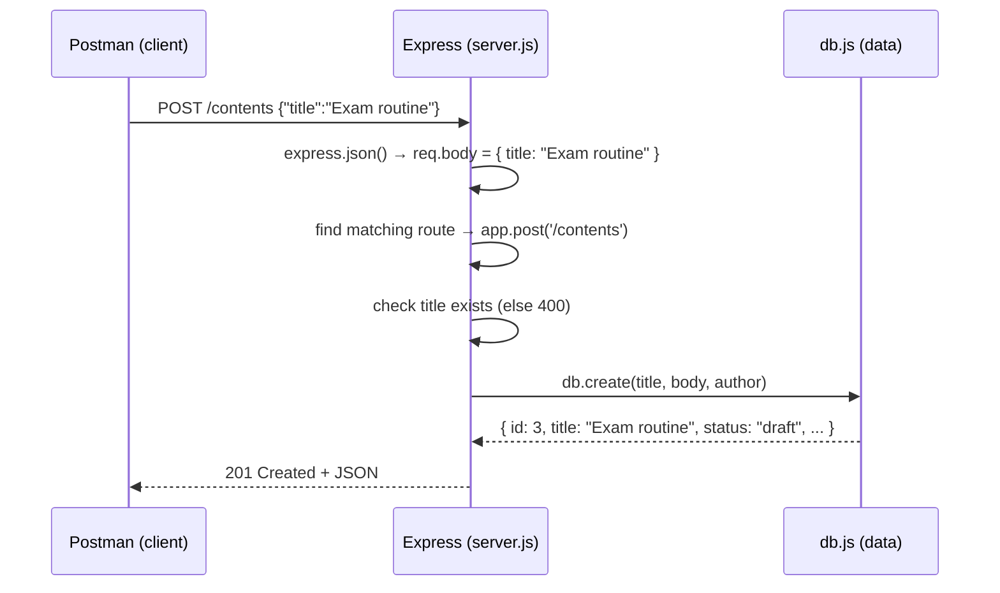

# Content Management API — CSE470 Lab 04

A small **CRUD API** (Create, Read, Update, Delete) for blog posts, built with **Express.js** and tested with **Postman**.
Data is kept in memory, so you don't need MySQL or XAMPP.

```
server.js                         → the API routes (what URL does what)
db.js                             → the data (an array of posts + 5 functions)
CMS-API.postman_collection.json   → ready-made Postman requests
package.json                      → project info, dependency (express) and the start command
```

---

## 1. Run the server

### In GitHub Codespaces (nothing to install)
1. On this repo page: **Code → Codespaces → Create codespace on main** (or open your existing one).
2. In the terminal:
   ```bash
   npm install      # downloads express into node_modules/
   npm start        # runs: node server.js
   ```
3. You should see:
   ```
   Server running on port 8000
   ```
4. Open the **Ports** tab → right-click port **8000** → **Port Visibility → Public**.
   Right-click again → **Copy Local Address**. It looks like `https://<codespace-name>-8000.app.github.dev`.

### On your own computer
Install [Node.js](https://nodejs.org) (LTS), then run the same two commands. The server is at `http://localhost:8000`.

> **Tip:** `node --watch server.js` restarts the server automatically every time you save a file.

---

## 2. Already running? Stop it and run again

Only **one** program can use port 8000 at a time. If you see this:

```
Error: listen EADDRINUSE: address already in use :::8000
```

the server is already running somewhere (often in another terminal tab).

| What you want | Command |
|---|---|
| Stop the server in **this** terminal | press **Ctrl + C** |
| Stop the server running in **any** terminal | `pkill -f "node server.js"` |
| Free port 8000, whatever is using it | `fuser -k 8000/tcp` |
| Check whether something is using port 8000 | `lsof -i :8000` |
| Start again | `npm start` |

Stopping and starting again also **resets the data** to the 2 sample posts, because the data only lives in memory.

> In Codespaces, check the **Ports** tab after restarting. If port 8000 has gone back to **Private**, set it to **Public** again, or Postman will get a GitHub login page instead of JSON.

---

## 3. Test the API

### Endpoints

| CRUD | Method | URL | Body (raw JSON) | Success | Error |
|---|---|---|---|---|---|
| Create | `POST` | `/contents` | `{"title": "...", "body": "...", "author": "..."}` | `201` new post | `400` if no title |
| Read all | `GET` | `/contents` | — | `200` list | — |
| Read filtered | `GET` | `/contents?status=published` | — | `200` list | — |
| Read one | `GET` | `/contents/:id` | — | `200` post | `404` |
| Update | `PUT` | `/contents/:id` | only the fields to change, e.g. `{"status": "published"}` | `200` post | `404` |
| Delete | `DELETE` | `/contents/:id` | — | `200` | `404` |

### Quick test from the terminal (curl)
Open a **second** terminal (the first one is busy running the server):

```bash
curl localhost:8000/contents                                   # read all
curl localhost:8000/contents/1                                 # read one
curl -X POST localhost:8000/contents \
     -H "Content-Type: application/json" \
     -d '{"title":"Exam routine","author":"Arif"}'             # create → id 3
curl -X PUT localhost:8000/contents/3 \
     -H "Content-Type: application/json" \
     -d '{"status":"published"}'                               # update
curl "localhost:8000/contents?status=published"                # filter
curl -X DELETE localhost:8000/contents/3                       # delete
curl localhost:8000/contents/3                                 # → 404
```

### Test with Postman
1. Open [Postman](https://web.postman.co) (or [Hoppscotch](https://hoppscotch.io), no account needed).
2. **Import** `CMS-API.postman_collection.json` from this repo.
3. Click the collection → **Variables** → set `baseUrl` to your server address
   (`http://localhost:8000`, or your public Codespaces address with no `/` at the end) → **Save**.
4. Send the requests **top to bottom**: `1. Create` → `2. Read` → `3. Update` → `4. Delete`.
   "Create content" saves the new post's id in `{{contentId}}`, so the later requests use it automatically.
5. Look at the **status code**, the **response body**, and the **Test Results** tab.
6. To run everything at once: click the collection → **Run** → **Run collection**.

---

## 4. How the code runs (execution flow)

### When you run `npm start`
1. `npm start` runs the `start` script in `package.json` → `node server.js`.
2. `server.js` imports **express** and **db.js**. Importing `db.js` creates the `contents` array with the 2 sample posts.
3. `app.use(express.json())` is registered. It runs **before every route** and turns the JSON request body into `req.body`.
4. Each `app.get / app.post / app.put / app.delete(...)` **registers** a route. Nothing runs yet; Express only remembers "for this method + URL, call this function".
5. `app.listen(8000)` starts the server and prints `Server running on port 8000`. Now it waits for requests.

### When a request arrives
Example: Postman sends `POST /contents` with body `{"title": "Exam routine"}`.



Step by step:
1. **Request in:** Postman sends the method, the URL and (for POST/PUT) a JSON body.
2. **Middleware:** `express.json()` reads the body and puts it in `req.body`.
3. **Routing:** Express compares the **method + path** with the routes, top to bottom, and runs the first match.
   - `/contents/3` matches `/contents/:id`, so `req.params.id = "3"` (a **path param**).
   - `/contents?status=published` matches `/contents`, so `req.query.status = "published"` (a **query param**).
   - No match (e.g. `/content`) → Express sends its own `404 Cannot POST /content`.
4. **Handler:** the route function checks the input, then calls a function in `db.js`.
5. **Data layer:** `db.js` reads or changes the `contents` array and returns the result (or `undefined` if the id doesn't exist).
6. **Response out:** the handler chooses the status code and sends JSON:
   - `res.status(201).json(...)` → created
   - `res.json(...)` → `200 OK` (the default)
   - `res.status(404).json(...)` / `res.status(400).json(...)` → errors
   - `return res.status(...)` stops the function there, so only **one** response is sent.

### Which route calls which db function

| Request | Route in `server.js` | Function in `db.js` | Uses |
|---|---|---|---|
| `POST /contents` | `app.post('/contents')` | `create(title, body, author)` | `req.body` |
| `GET /contents` | `app.get('/contents')` | `getAll(status)` | `req.query.status` |
| `GET /contents/:id` | `app.get('/contents/:id')` | `getById(id)` | `req.params.id` |
| `PUT /contents/:id` | `app.put('/contents/:id')` | `update(id, changes)` | `req.params.id` + `req.body` |
| `DELETE /contents/:id` | `app.delete('/contents/:id')` | `remove(id)` | `req.params.id` |

---

## 5. Common errors

| Error | Cause | Fix |
|---|---|---|
| `EADDRINUSE ... :8000` | server already running | see section 2 |
| `Cannot use import statement outside a module` | `"type": "module"` missing in `package.json` | `npm pkg set type=module` |
| `Cannot destructure property 'title' of 'req.body'` | `express.json()` missing, or Postman body not **raw → JSON** | add `app.use(express.json())` / fix Postman body |
| `Cannot GET /content` | wrong path or method | use `/contents` and the right method |
| Postman returns an HTML login page | Codespaces port is Private | Ports tab → Public |
| Postman web: *Could not send request* to `localhost` | Postman web can't reach localhost | use the public Codespaces address |
